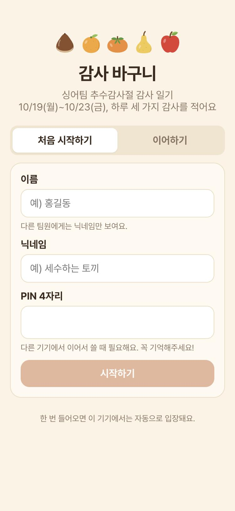
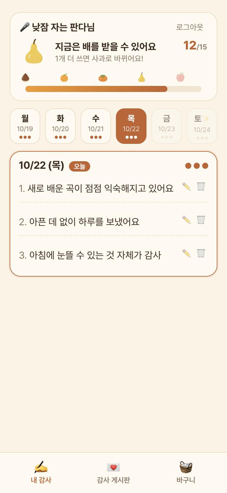
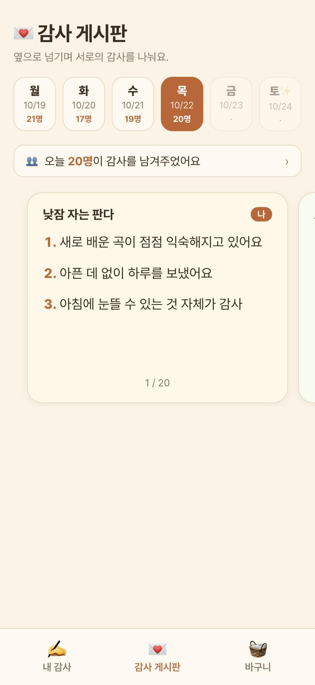
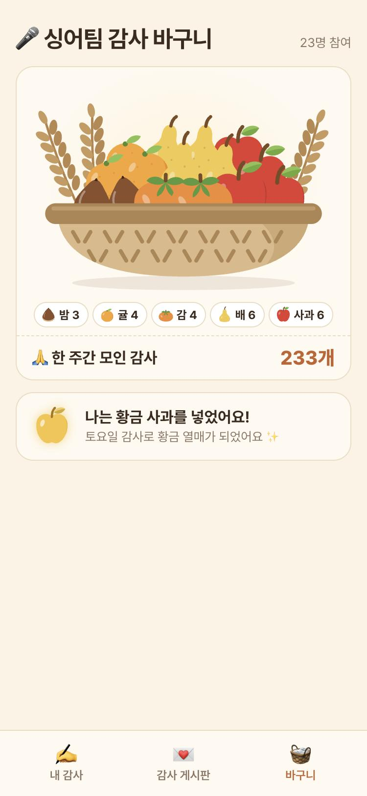
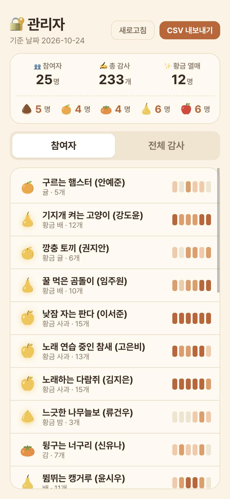

<div align="center">

# 🧺 감사 바구니

**교회 싱어팀을 위한 추수감사절 감사 일기 웹앱**

하루 세 가지 감사를 적고, 한 주 동안 모은 감사만큼 열매를 받아<br/>
토요일에 다 함께 하나의 바구니를 채웁니다.

[**🔗 thanks-basket.vercel.app**](https://thanks-basket.vercel.app)


</div>

<br/>

| 시작하기 | 내 감사 | 감사 게시판 | 감사 바구니 | 관리자 |
|:---:|:---:|:---:|:---:|:---:|
|  |  |  |  |  |

<br/>

## 💡 왜 만들었나

추수감사절을 맞아 싱어팀 25명이 **한 주 동안 하루 세 가지씩 감사 일기**를 쓰기로 했습니다.
단톡방에 올리면 금방 묻히고 딱딱하게 느껴져서, **링크 하나로 들어와 미니게임처럼** 참여할 수 있는 작은 웹앱을 만들었습니다.

- 평일 5일 × 3개 = **최대 15개**의 감사를 모을수록 더 큰 열매가 **해금**되고, 그중 하나를 골라 바구니에 넣습니다.
- 토요일에는 각자 받은 열매를 **팀 공동 바구니**에 넣으며 한 주를 마무리합니다.
- 실제 과일도 이 결과대로 나눠 줍니다. 🍎

<br/>

## ✨ 주요 기능

### ✍️ 내 감사
- **날짜 탭(월~토)** 으로 하루씩 감사 3칸을 채우고, 수정·삭제할 수 있어요.
- 지난 평일은 일요일까지 채울 수 있고, 아직 오지 않은 날은 잠겨 있어요.
- 열매 게이지가 **5단계 해금**을 보여주고, "3개 더 쓰면 수박 해금!"처럼 다음 목표를 알려줘요. 카드를 누르면 **열매 도감**이 열려요.
- **토요일 보너스 감사**: 개수에는 들어가지 않지만, 하나라도 쓰면 내 열매가 **황금 열매**가 돼요.

### 💌 감사 게시판
- 날짜를 고르면 그날 감사를 쓴 사람들의 카드가 나오고, **좌우로 넘기며** 읽을 수 있어요.
- 내 카드는 항상 첫 장이에요. 아직 안 썼다면 그 자리에 **"감사 쓰러 가기"** 카드가 나와요.
- "오늘 20명이 감사를 남겨주었어요"를 누르면 참여자 목록이 뜨고, 이름을 누르면 그 사람 카드로 바로 이동해요.

### 🧺 감사 바구니
- 토요일이 되면 해금된 열매 중 **하나를 골라** [넣기]를 눌러요. 열매가 위에서 떨어져 바구니에 쏙 들어가요.
- 넣은 사람 수만큼 과일이 **하나씩 쌓이고**(최대 15개), 그 뒤로는 실제 비율에 맞춰 구성만 바뀌어요.
- 한 과일만 잔뜩 쌓이지 않도록, 6개부터는 한 종류가 그림의 40%를 넘지 않게 섞어서 그려요.

### 🔐 관리자
- 참여자별 날짜별 개수, 받을 열매, 황금 여부를 한눈에 보고 **CSV로 내보낼** 수 있어요.
- PIN을 잊은 팀원의 **PIN 초기화**와 부적절한 글 삭제 기능이 있어요.
- 휴대폰에서도 보기 좋게, 페이지는 고정하고 목록만 안에서 스크롤돼요.

<br/>

## 🗓️ 진행 규칙

| 기간 | 할 수 있는 것 |
|---|---|
| ~ 10/18 | 가입만 가능 |
| **10/19(월) ~ 10/23(금)** | 하루 3개씩 감사 작성. 지난 평일도 일요일까지 채울 수 있음 |
| **10/24(토)** | 보너스 감사(황금 열매) · 바구니에 열매 넣기 |
| 10/25(일) | 지난 감사 마저 채우기 · 바구니 넣기 |
| 10/26(월) ~ | 결산. 감사는 읽기 전용, 바구니는 계속 볼 수 있음 |

| 단계 | 평일 감사 | 해금되는 열매 |
|---|:---:|---|
| 1 · 한입 열매 | 0~3 | 밤 · 올리브 |
| 2 · 손바닥 열매 | 4~6 | 무화과 · 귤 |
| 3 · 주먹 열매 | 7~9 | 사과 · 감 |
| 4 · 두손 열매 | 10~12 | 참외 |
| 5 · 아름드리 열매 | 13~15 | 수박 |

감사를 많이 쓸수록 더 큰 열매가 해금되고, 토요일에 **해금된 8종 중 하나를 직접 골라** 바구니에 넣어요.

<br/>

## 🛠️ 기술적으로 신경 쓴 점

**로그인 없는 본인 확인**
회원가입과 로그인 과정이 부담되지 않도록 **닉네임 + 4자리 PIN**만 받았어요. 한 번 들어오면 기기에 세션 토큰이 저장돼 자동으로 입장해요.
- PIN은 `scrypt`로 해시해서 저장하고, 세션 토큰도 해시로만 보관해요.
- 같은 닉네임으로 **5번 틀리면 5분간 잠겨서** 4자리 PIN을 무작위로 시도할 수 없어요.
- 실명은 관리자 화면에서만 보이고, 팀원용 API 응답에는 아예 포함하지 않아요.

**모든 규칙은 서버에서, 한국 시간 기준으로**
"오늘 쓸 수 있는 날짜인지", "바구니가 열렸는지" 같은 규칙을 `lib/rules.ts` 한곳에 모았어요. 클라이언트는 화면 표시에만 쓰고, 실제 판단은 서버가 **KST 기준**으로 다시 해요. 기기 시계를 바꿔도 우회할 수 없어요.

**로컬에선 내장 DB, 배포에선 Supabase. 같은 SQL 한 벌**
`DATABASE_URL`이 없으면 [PGlite](https://pglite.dev)(WASM Postgres)로 바로 실행되고, 있으면 Supabase Postgres에 붙어요. ORM 없이 같은 SQL을 그대로 쓰고, 테이블은 첫 요청 때 자동으로 만들어져요.

**날짜를 바꿔가며 개발하기**
행사가 정해진 날짜에만 열리기 때문에, 개발 모드에서만 보이는 🛠 **날짜 미리보기** 도구를 만들었어요. 날짜를 고르면 그 날짜에 맞춰 데모 팀원 24명의 감사와 바구니가 다시 채워져요. 배포 환경에서는 이 기능이 완전히 꺼져요.

**직접 그린 일러스트**
과일 8종과 바구니, 밀 이삭을 이미지 파일 없이 **SVG 코드로 직접** 그렸어요. 바구니 속 과일은 줄마다 엇갈리고 가운데가 봉긋하게 쌓이며, 같은 과일끼리 옹기종기 모이도록 자리를 계산해요.

**한 화면 안에서 끝나는 모바일 UI**
세 탭 모두 스크롤 없이 한 화면에 들어오도록 구성했어요. 긴 글은 카드 안에서만 스크롤되고, 넘기는 동작과 겹치지 않게 했어요.

<br/>

## 🧱 구조

```
src
├── app
│   ├── page.tsx            # 팀원 화면 (가입 · 내 감사 · 게시판 · 바구니)
│   ├── admin/page.tsx      # 관리자 화면
│   └── api
│       ├── auth            # 가입 · 이어하기(PIN) · 로그아웃
│       ├── me              # 내 감사와 열매 상태
│       ├── entries         # 감사 작성 · 수정 · 삭제
│       ├── board           # 날짜별 감사 카드
│       ├── basket          # 바구니 현황 · 열매 넣기
│       ├── admin           # 관리자 조회 · PIN 초기화 · 삭제
│       ├── health          # 배포 점검 (관리자 전용)
│       └── dev             # 개발용 데모 데이터 (배포 시 404)
├── components
│   ├── Fruit.tsx           # SVG 과일 일러스트 (황금 버전 포함)
│   └── DevBar.tsx          # 개발용 날짜 미리보기
└── lib
    ├── rules.ts            # 행사 기간 · 열매 기준 · 작성 가능 여부 (공용)
    ├── server.ts           # KST 날짜 · PIN 해시 · 세션
    ├── stats.ts            # 사람별 개수 · 열매 · 황금 여부 집계
    └── db.ts               # PGlite / Postgres 연결과 스키마
```

<br/>

## 🚀 실행하기

```bash
npm install
npm run dev
```

`DATABASE_URL` 없이도 내장 DB(`.pglite/`)로 바로 실행돼요. 오른쪽 아래 🛠 버튼으로 날짜를 바꾸고, 데모 팀원을 채워서 모든 화면을 미리 볼 수 있어요.

| 환경 변수 | 설명 |
|---|---|
| `DATABASE_URL` | Supabase **Transaction pooler** 주소 (`…pooler.supabase.com:6543`). 비우면 내장 DB 사용 |
| `ADMIN_PASSWORD` | 관리자 화면(`/admin`) 비밀번호 |

**배포**: GitHub `main` 브랜치에 push하면 Vercel(서울 리전)이 자동으로 배포해요.
